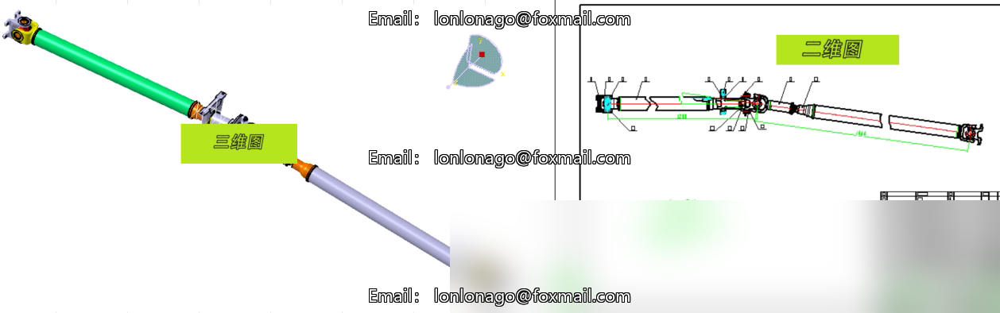
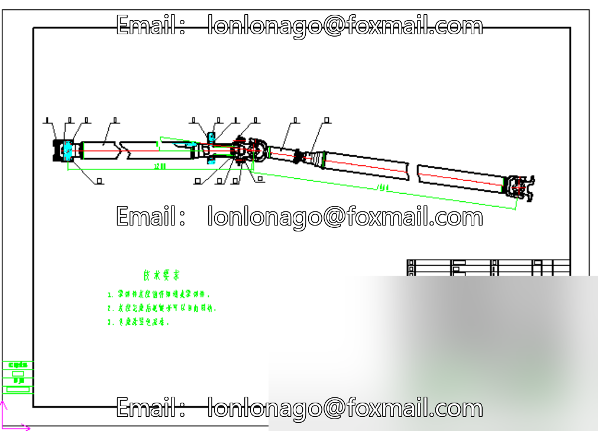

# 192 lightweight truck drive shaft design, drive shaft design drawing, drive shaft design CAD drawing

## Body

192 Light Truck Shaft Design Designation Shaft Design Drawing Shaft Design CAD Drawing Shaft Design Three-Dimensional Figure
This design is for the design of a truck transmission shaft, including three-dimensional, two-dimensional, and design manuals. The two-dimensional engineering diagrams contain two assembly drawings.

The content covers the 192 light freight truck shaft design, including 3D, 2D design documents and design handbook; it also contains 3D, 2D and design drawings along with text files.

<!-- AI_ENRICHED -->

## Images

## Payment

Here is a pay link on Stripe ( https://buy.stripe.com/3cs8yP7sY87d0vu9AB ). Please contact me lonlonago@foxmail.com after funding $89, and I will send you a complete data files , thank you!

